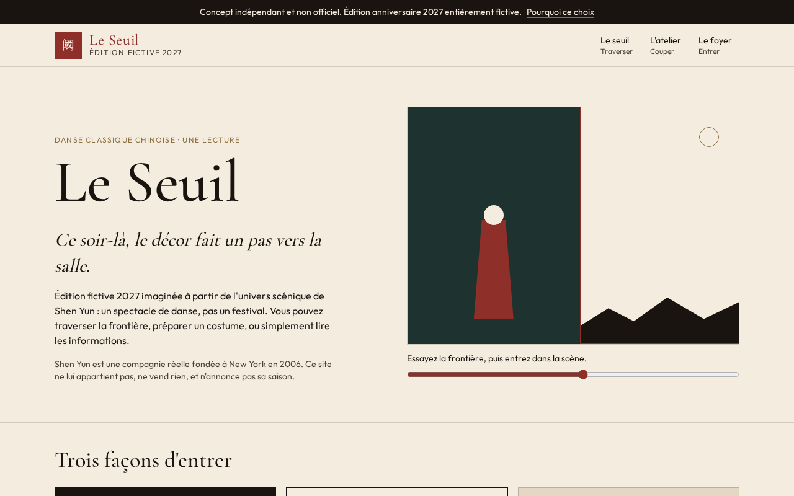
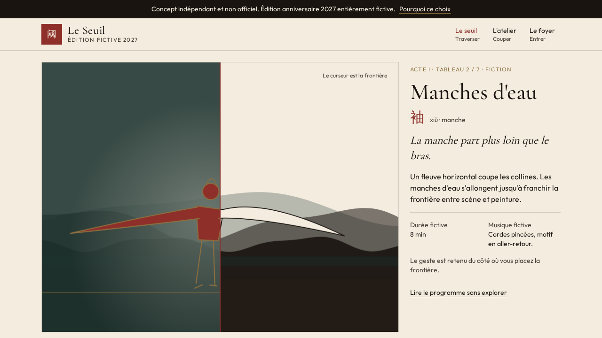
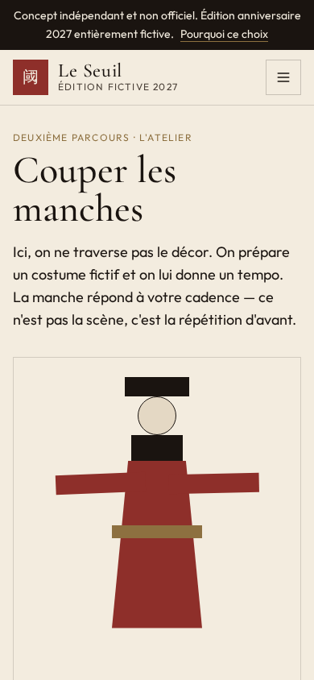
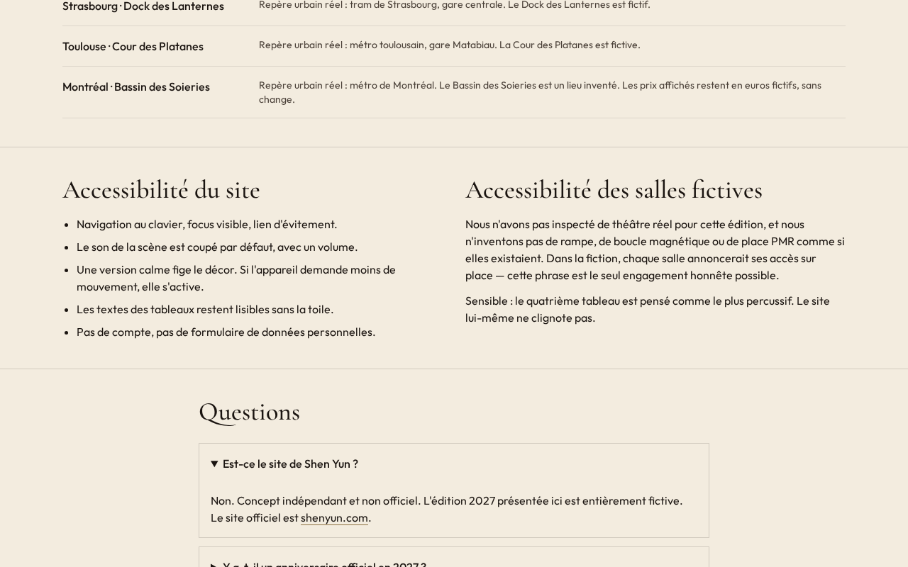

# Daybreak — Le Seuil

**Prototype expérimental créé par Grok 4.7**, selon la version communiquée par le commanditaire, en réponse au brief « Live Experience 2027 — Creative Web Experience Challenge ». Le projet explore une édition anniversaire 2027 imaginée autour de Shen Yun.

> **Concept indépendant et non officiel. Édition anniversaire 2027 entièrement fictive.** Le Seuil n’est ni une annonce, ni un site, ni une commande de Shen Yun. Les spectacles, salles, dates, prix et réservations présentés sont inventés. Aucun achat réel n’est réalisé.


*Capture du prototype final en environnement de production local, enregistrée par Grok ; fenêtre 1280 × 800. Ce n’est pas une maquette préparatoire.*

## La demande et le choix

Le brief demandait de comparer cinq organisations de spectacle ou de festival, d’en sélectionner une, puis de concevoir une édition anniversaire fictive 2027. Il imposait deux formes d’exploration et un accès pratique direct, une interface adaptée aux appareils et aux usages au clavier, une transparence sur la fiction, aucune transaction réelle et un prototype localement navigable.

Grok a retenu **Shen Yun**, une compagnie de spectacle itinérant, pour explorer une idée : la frontière entre un corps dansant et un paysage peint. La page `/sources` du projet présente cette frontière comme une **interprétation créative**, pas comme une propriété démontrée par les extraits consultés. L’hypothèse est qu’un spectateur pourrait souhaiter comprendre et ressentir le spectacle avant de chercher une ville ou un billet ; aucun test utilisateur n’est documenté pour l’établir.

La comparaison suivante résume la page de sources rédigée par Grok ; ces observations correspondent à sa recherche, non à une nouvelle vérification lors de la publication.

| Organisation | Éléments rapportés par Grok | Choix, interprétations et limites |
| --- | --- | --- |
| [Shen Yun](https://www.shenyunperformingarts.org/) | Compagnie basée à New York, danse, chant, orchestre et tournée. | Retenue pour le geste scénique et sa relation imaginée au décor. L’accueil shenyun.com n’a pas fourni de contenu exploitable dans son outil. |
| [Hellfest](https://hellfest.fr/) | Festival à Clisson ; une édition réelle 2027 était annoncée. | Grok a préféré le langage d’une scène et d’un corps à celui d’un festival, tout en évitant une confusion avec l’annonce officielle. |
| [Cirque du Soleil](https://www.cirquedusoleil.com/) | Des spectacles et une création réelle en 2027 étaient évoqués. | Son univers a été jugé vaste et déjà très identifié. |
| [Country Jam](https://countryjam.com/) | L’accueil consulté mettait en avant pass et bracelets. | Grok a considéré le parcours visible comme davantage transactionnel ; c’est une interprétation. |
| [Lollapalooza Stockholm](https://lollastockholm.com/) | L’accueil n’a pas livré de contenu exploitable. | Informations insuffisantes pour approfondir sans inventer. |

Grok indique ne pas avoir inspecté visuellement les cinq sites officiels sur ordinateur ou mobile et ne pas avoir testé de parcours d’achat réel. La [page des sources](src/routes/sources.tsx) conserve sa comparaison, ses interprétations, les informations manquantes et les liens qu’il cite.

## L’expérience

- **Accueil** : trois portes vers les parcours.
- **Le Seuil** (`/seuil`) : sept tableaux fictifs ; une frontière verticale sépare le corps et la peinture. Interaction par souris, tactile ou glissière ; son synthétisé facultatif, coupé au départ.
- **L’Atelier** (`/atelier`) : choix d’étoffes et de tempo produisant une lecture et un tableau. Le carnet est conservé dans le navigateur seulement.
- **Le Foyer** (`/foyer`) : programme, tournée, accès, accessibilité, FAQ et billet simulé, sans transaction.
- **Sources** (`/sources`) : comparaison des candidats et distinction entre faits rapportés, interprétations et éléments non consultés.

Les villes et quelques repères de transport existent ; les salles, les dates, les tableaux, les prix et les modalités de la fiction sont inventés. Le projet ne constitue pas une réservation.


*Capture du prototype final conservée dans le projet : tableau « Manches d’eau », scène interactive. La date et les dimensions de capture ne sont pas consignées dans ce fichier.*


*Capture du prototype final conservée dans le projet : parcours Atelier en format mobile. Les dimensions exactes et la date ne sont pas consignées dans ce fichier.*


*Capture du prototype final conservée dans le projet : exemple de billet simulé du Foyer. Aucun achat n’est effectué.*

Aucune maquette préalable identifiable avec certitude ni journal complet des décisions n’a été retrouvé dans les fichiers examinés. Les images ci-dessus sont des captures existantes du prototype ; les descriptions du choix viennent de sa page Sources et du README original, pas d’une reconstitution d’étapes non observées.

## Technique et lancement

Le projet utilise React, TypeScript, TanStack Start / Router, Vite et Tailwind CSS. La version fournie était configurée pour un rendu serveur Nitro/Vercel : **le code source ne peut pas être servi directement par GitHub Pages comme un simple site statique**. Une adaptation et des tests seraient nécessaires pour une démonstration Pages.

Prérequis : Node.js et npm. Dans le dossier du projet :

```sh
npm ci
npm run dev
```

Le README d’origine indique un serveur de développement sur le port 8080 ; pour une production locale il propose `npm run build` puis `npm run preview`. Lors de la préparation sous Windows, `npm ci --ignore-scripts` a abouti, mais `npm run build` a échoué avec `spawn vite ENOENT` ; le lancement et la production ne sont donc pas confirmés dans cet environnement. Les dépendances et configurations de la plateforme d’origine sont conservées, mais les fichiers locaux d’environnement et le secret de prévisualisation ont été exclus de la version publique. La connexion de prévisualisation Grok n’est donc pas configurée dans cette copie.

| Dossier | Contenu |
| --- | --- |
| `src/routes/` | Les cinq pages de l’expérience. |
| `src/components/` | Scène, atelier, foyer et éléments communs. |
| `src/lib/edition.ts` | Tableaux, villes et contenus fictifs. |
| `screenshots/` | Captures et résultats de contrôle conservés du projet original. |
| `public/`, `server/`, `scripts/`, `migrations/` | Ressources et infrastructure du projet d’origine. |

## Vérifications et limites

Les fichiers `screenshots/app-builder-preview.json` et `screenshots/app-builder-built.json` consignent les vérifications produites dans l’environnement Grok : page d’accueil en **1280 × 800** et **390 × 844**, réponse HTTP 200, pas d’erreur console ou de débordement horizontal relevé dans ces captures, et pas de divergence signalée entre aperçu et production locale. Ce sont les résultats conservés du projet ; ils n’ont pas été reproduits lors de la publication. Ils ne prouvent pas à eux seuls le fonctionnement de toutes les interactions, ni une conformité d’accessibilité complète.

Le site prévoit une alternative sans son et des contrôles accessibles ; aucun audit indépendant ou test sur appareils physiques n’est documenté ici. Un `npm audit --omit=dev` exécuté lors de la publication a signalé quatre vulnérabilités dans les dépendances (deux faibles, une élevée et une critique) ; elles n’ont pas été corrigées ni évaluées pour leur impact réel sur ce prototype. Durée exacte, consommation de tokens et coût ne sont pas connus. Le potentiel public et les besoins décrits restent des hypothèses de conception.

## Ressources et contexte

Le code et les visuels du projet sont ceux trouvés dans le dossier Grok. Les captures du prototype sont conservées dans `screenshots/`. Le dépôt comporte une [licence MIT](LICENSE) fournie par son propriétaire ; les droits et licences des dépendances tierces restent ceux de leurs auteurs. Les organisations citées ne sont pas partenaires du projet. La version précise **Grok 4.7** a été fournie par le commanditaire ; elle n’a pas été déduite des fichiers.

Les réussites visibles sont la cohérence de la fiction, les deux parcours et l’accès direct aux informations. Les limites principales sont l’absence de validation utilisateur documentée, la dépendance au cadre technique d’origine et l’absence actuelle d’une version GitHub Pages vérifiée.
